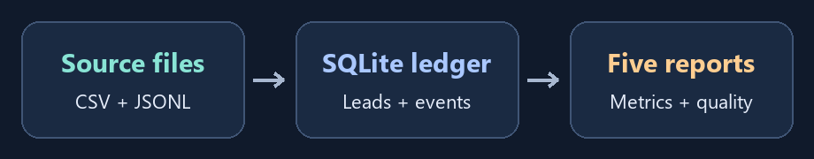

# Interaction Ledger & Reporting Pipeline

**Agentic Universe · Junior SDE take-home · Assignment A**

Import messy lead CSVs and out-of-order call events into SQLite, then generate five reproducible reports. Built for **Python 3.11+** with the standard library.

<p align="center">
  
</p>

[Quick start](#quick-start) · [Report outputs](#report-outputs) · [Design and test results](SUBMISSION.md) · [AI disclosure](AI_USAGE.md)

## Quick start

From the repository root, run this PowerShell demo against a fresh database. [Bash instructions](SUBMISSION.md#how-to-run) are also available.

```powershell
python assignment-a-data/tools/generate_data.py --seed 42 --scale small --out data
$env:LEDGER_HMAC_KEY = python -c "import secrets; print(secrets.token_hex(32))"
python -m solution --db demo.sqlite3 ingest data/drop_1 data/drop_2
python -m solution --db demo.sqlite3 report --out reports
python -m unittest discover -v
```

Reuse the same key for future imports into this database. The report command can run without the key.

## Architecture

| Stage | Responsibility |
| :--- | :--- |
| **Validate inputs** | Resolve CSV headers against the workflow schema, normalize values and record rejected rows. |
| **Persist in SQLite** | Merge leads by workflow and keyed phone identity. Store each event ID once in the append-only ledger. Commit the drop and its counters together. |
| **Resolve call history** | Match events against the current lead set. Later drops can resolve earlier orphans. Valid supervisor overrides take precedence over automated dispositions. |
| **Build reports** | Read one consistent snapshot and derive batch, daily and lead metrics alongside rejection and quality outputs. |

**Privacy and replay.** SQLite stores keyed hashes for names and phone identities. The lead report uses a masked phone number. An exact drop replay leaves the database unchanged.

## Report outputs

| File | What it shows |
| --- | --- |
| `batch_summary.csv` | Lead counts by batch and progress bucket |
| `daily_overview.csv` | Daily call volume, connectivity and distinct successful leads in IST |
| `lead_report.csv` | Masked lead-level call history summary and effective disposition |
| `rejections.csv` | Row-level rejection reasons without raw lead values |
| `data_quality.json` | Ingestion totals, duplicates, warnings and unresolved events |

## Verification

Five automated tests cover validation, disposition priority, lead buckets, replay, rollback and checks for plaintext PII. On synthetic seeds **42** and **137**, separate and combined imports produced byte-identical reports. Replaying the drops left the database bytes unchanged.

[Source code](solution/) · [Assignment specification](assignment-a-data/README.md) · [Original repository instructions](docs/UPSTREAM_README.md)
